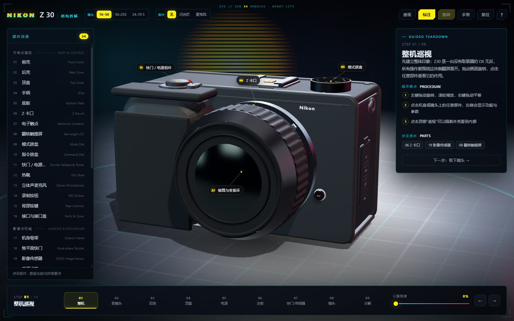
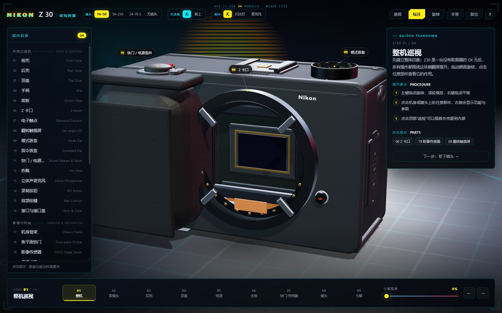
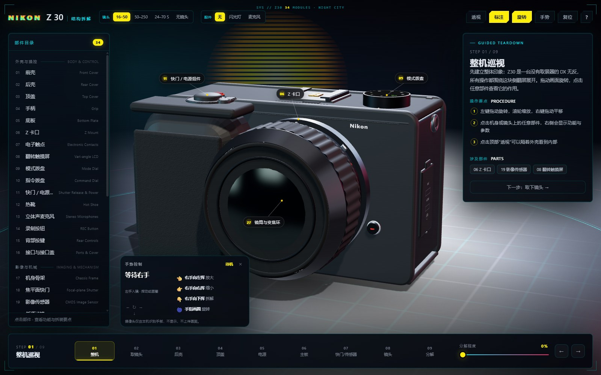
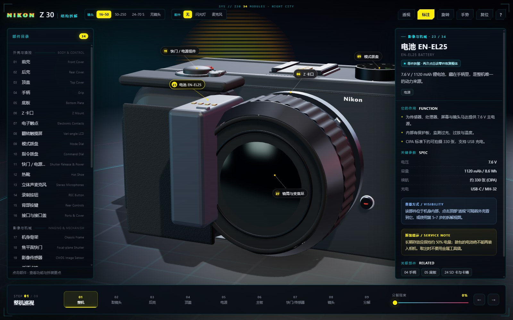

# Nikon Z30 · Cyberpunk 3D Teardown

一个**单文件、可离线**（手势模型首次需联网）的 three.js 交互式拆解模型：34 个部件、9 步拆解、3 支可换镜头、无镜头 / 机身盖模式、2 个可拆装配件，以及摄像头手势控制。

赛博朋克 2077 风格的霓虹网格、条纹太阳与青/品红 HUD；模型使用 Blender 5.2 烘焙的机身细纹与手柄皮革 PBR 贴图。



## 功能

| 模块 | 内容 |
| --- | --- |
| 拆解 | 34 个部件、9 步指引、0–100% 连续分解 |
| 镜头 | 16–50 / 50–250 / 24–70 S，以及**无镜头** |
| 机身盖 | 无 / 装上；取下机身盖可直接看到 **CMOS 传感器** |
| 配件 | 闪光灯、机顶麦克风，可拆装 |
| 手势 | MediaPipe：握拳↔张开缩放、食指滑动旋转、双掌拆解/复原 |
| 单件视图 | 点击任意部件自动取景，再次点击恢复整机 |
| 主题 | 霓虹网格、条纹太阳、HUD 角标、青/品红轮廓光 |

## 快速开始

1. 下载或克隆本仓库。
2. 直接双击 `index.html`（Chrome / Edge 均可）。
3. three.js、CSS、贴图全部内联，**不需要联网，也不需要本地服务器**。

## 操作

| 操作 | 效果 |
| --- | --- |
| 左键拖动 | 旋转 |
| 滚轮 / 双指捏合 | 缩放 |
| 右键拖动 / Shift + 拖动 | 平移 |
| 点击部件 / 标签 / 左侧目录 | 单件放大取景 + 功能参数 |
| 再次点击同一部件 | 恢复整机状态 |
| 顶部「镜头」 | 换镜，或选择「无镜头」 |
| 顶部「机身盖」 | 无 / 装上（仅无镜头时出现） |
| 顶部「配件」 | 闪光灯 / 麦克风 |
| 底部 01–09 | 切换拆解步骤 |
| 底部滑块 | 0–100% 连续分解 |

## 无镜头 · 机身盖 · CMOS

选择「无镜头」后，卡口打开；旁边的「机身盖」可以切换：

- **无**：快门帘与 OLPF 隐藏，直接看到 CMOS（金色封装框 + 橙色排线）。
- **装上**：带 Nikon 字样的机身盖盖住卡口。



## 手势控制（MediaPipe Hands）

点击顶部「手势」，首次加载 MediaPipe Hands（约 5–10 秒，需联网），再授权摄像头。画面**不显示、不上传、不保存**。

| 手势 | 动作 |
| --- | --- |
| 握拳 → 张开 | 放大 |
| 张开 → 握拳 | 缩小 |
| 食指左右滑动 | 旋转 |
| 双掌合拢 → 左右分开 | 拆解 |
| 双掌分开 → 合拢 | 复原 |



> 需要 `https` 或 `localhost`。MediaPipe 资源从 CDN 加载（jsDelivr → unpkg）；如网络不通，可把 `@mediapipe/hands` 的 `hands.js` 与 assets 放到 `./mediapipe/`。摄像头帧仅在本机处理；GitHub Pages 可直接使用。

## 单件视图

点击任意部件会把该零件拉到镜头前，其余机身保持整机未拆解；相机按包围盒自动取景。再次点击同一零件、点空白处或「返回整体视图」即可恢复。



## 技术

- three.js r169（构建时内联，运行时无外部依赖）
- 单文件 HTML，约 1.4 MB（含 base64 贴图）
- Blender 5.2 / Cycles 烘焙：机身细纹法线、手柄皮革颜色/粗糙度/法线
- 程序化几何 + Canvas 贴图：模式盘、按键图标、端口标签、镜头铭文
- MediaPipe Hands（CDN 加载，最多 2 只手；21 点关键点；摄像头帧仅本机处理）

## 从源码构建

需要 Node.js 18+。

```bash
cd source
node build.js src/app ../index.html
```

或：

```bash
cd source
npm run build
```

目录：

```
source/
  build.js               # 把 three.js + CSS + app 合成单文件
  vendor/three.module.min.js
  src/template.html
  src/style.css
  src/app/*.js           # 00-utils / 10-data / 20-build / 25-lens / 27-accessories
                         # 30-scene / 35-gesture / 40-ui / 0-baked
```

## 部署到 GitHub Pages

1. 新建一个仓库（例如 `nikon-z30-3d-teardown`）。
2. 上传**本文件夹里的内容**，确保 `index.html` 在仓库根目录。
3. 仓库 **Settings → Pages**：
   - Source: **Deploy from a branch**
   - Branch: **main**，目录选 **/ (root)**
4. 保存后等待 1–2 分钟，访问 `https://<你的用户名>.github.io/<仓库名>/`。

仓库已包含 `.nojekyll`，避免 GitHub Pages 对文件做 Jekyll 处理。

## 已知限制

- 这是程序化 + 近似的教学模型，不是 1:1 扫描或维修手册；手柄曲线、分缝、镜头/屏幕细节仍是简化版。
- 屏幕默认为闭合状态；镜头为通用 Nikkor Z 镜筒，不是照片中那支第三方手动镜头。
- 手势识别对光线和背景敏感，建议在均匀光线下使用。

## 免责声明

本项目为非官方、粉丝制作的教学可视化，与 Nikon Corporation 无关联。Nikon、Z30、NIKKOR 等名称与商标归其各自所有者。参考实拍照片未包含在本仓库中。

## License

MIT，见 [LICENSE](LICENSE)。
